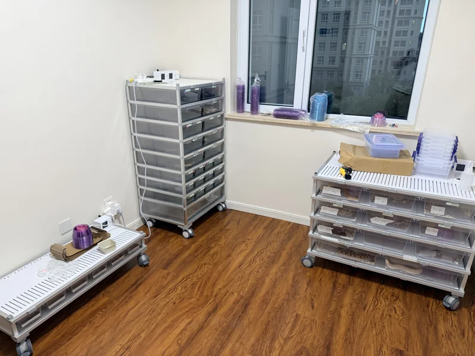
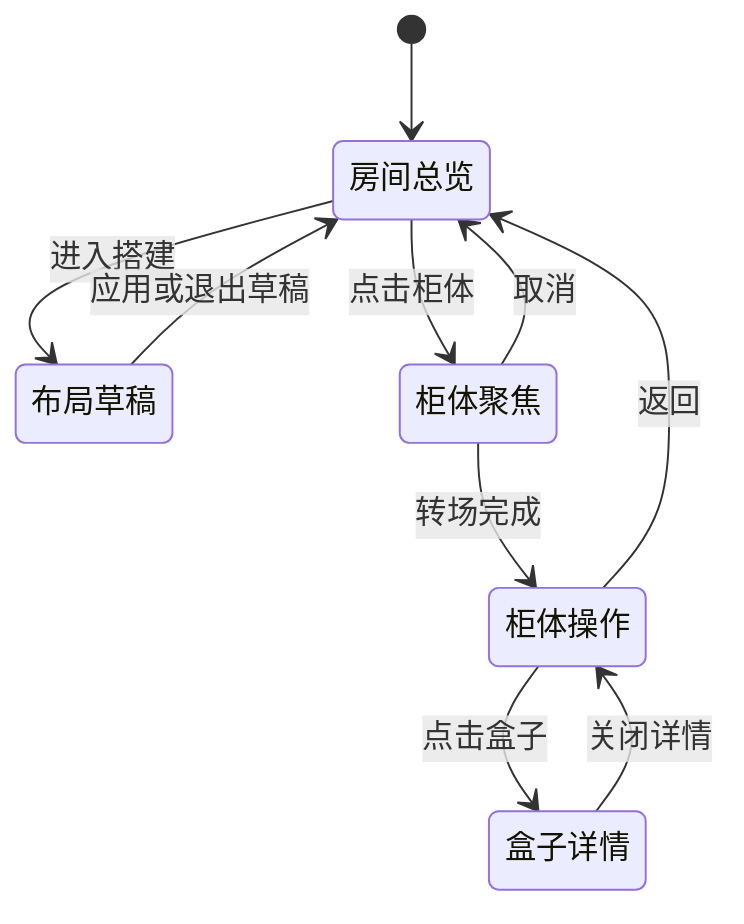

# 爬房搭建模块：空间建模、交互与动画设计方案

> 2026-10-13 更新：一期日常操作补强及二期孵化箱首版已实现。冬化／孵蛋用途与繁育计划关联约束、勾选验收清单见[实际交付记录](爬房工作台实现与验收.md)。下文分阶段章节保留原始规划，后续项目不自动纳入本次交付。

> 当前代码的交付范围、上线步骤及验收证据见[爬房工作台实现与验收](爬房工作台实现与验收.md)。本文保留完整目标设计，未勾选的清单不代表当前版本全部实现。

日期：2026-10-13

状态：设计提案，供产品与开发落地；本文不代表功能已经实现。

适用范围：现有管理后台内的单房间爬房模块。

## 1. 产品方向

把真实爬房做成一个能逐步搭建、能定位每条蛇、能直接完成日常照料的空间工作台。

**推荐体验：默认进入房地产户型图式的俯视房间；可以切换有材质和纵深的立体视角；点击任意柜子，相机连续转向并靠近柜体正面，柜子占满当前工作区；点击盒子即可放置、转移蛇只、看标签和记录喂食。**

优雅感来自三个方面：房间与柜子始终对应同一套空间结构；视图切换保留方位感；标签和工具只在需要的层级出现。炫技重点放在“户型图变成立体爬房”“柜体连续展开”“架子逐层搭起”这三个动作上。

首版必须形成完整闭环：建房间 → 放柜子 → 逐层配置 → 分配现有蛇只 → 查看标签 → 配置柜级／格级排期 → 按周计划备料与喂食。体重与鼠重对应规则作为可编辑的初始配置，见第 9.2 节；频率和时间由后台配置，不硬编码饲养周期。

本轮范围确认：**一期实现银色爬柜、参数化长方形盒体、可配置鼠重规则、逐柜备料汇总、柜级与格级排期、周计划高亮联动；孵化柜展示及相关操作统一放在二期。**

## 2. 真实照片与现有项目依据

### 2.1 照片可以确认什么

参考现有真实素材：[爬房照片](../../assets/photos/breeding-room-1600.webp)。



照片中可见白色墙面、木纹地板、大窗、银色金属框架、透明或半透明抽屉盒、脚轮和贴在盒子正面的标签。架子有高窄、宽矮和低矮长条三种明显比例，部分架子不同层的盒子尺寸和数量不同。

建模应保留这些识别特征：金属立柱、横梁、浅色层板、深浅不同的盒体、细小把手、底部脚轮、前置标签。窗台杂物、电线和所有微小零件不作为首版模型重点。

**照片只展示房间局部。完整长宽、门的位置、其余墙面、每层准确盒数和柜体尺寸均不能由此确认。** 初始场景可以参考可见陈设建立可编辑草稿，并标明“参考布局，尺寸待校准”；不把推测坐标写成实测结果，也不根据照片里的模糊标签绑定真实蛇只。

新增参考目录：[爬柜参考图](爬柜参考图/)。当前检查到三张图片：


| 图片                                                            | 可确认的视觉信息                         | 使用方式                         |
| --------------------------------------------------------------- | ---------------------------------------- | -------------------------------- |
| [密集小盒柜](爬柜参考图/cc1b78318001483be4bc2508a66a9ebd.jpg)   | 银色高架、多列浅抽屉、密集层板、底部脚轮 | 一期小盒多列模板的外观参考       |
| [逐层拆装示意](爬柜参考图/d4e317e1eca251b3c883ddb8bec2739d.jpg) | 银色框架、每层三只较宽透明盒、层板可叠加 | 一期加层动画及宽盒外观参考       |
| [宽盒柜全貌](爬柜参考图/f18de7aeb2c11a292757204039bffae3.jpg)   | 高柜、横向三列长方形盒体、侧板、脚轮     | 一期柜体比例、侧面和抽屉前脸参考 |

当前三张主图均可辨认为爬柜或拆层示意，未辨认到独立孵化箱主图。孵化柜二期再核对参考素材，不阻塞一期。仅使用图中几何和材质作为参考，商品价格、宣传文字及截图界面不进入模块；图示层数和列数不锁定后台配置。

### 2.2 已有能力与新增范围


| 内容                                 | 当前项目依据                                                   | 本模块处理                                             |
| ------------------------------------ | -------------------------------------------------------------- | ------------------------------------------------------ |
| 蛇只编号、性别、基因描述             | `snakes`；`js/workspace.js`                                    | 直接关联现有个体                                       |
| 结构化基因                           | `snake_genes`、`genes`；`js/data.js`                           | 标签读取同一来源，保留可能携带等状态                   |
| 体重和成长记录                       | `snake_measurements`；`js/workspace-upgrades.js`               | 复用有效测量与成长时间轴                               |
| 喂食类型记录                         | 迁移`027_growth_and_batch_registration.sql`                    | 现有类型与文本记录可复用，但不足以直接计算完整喂食计划 |
| 种群库／自繁库                       | `snakes.inventory_library`；迁移 `023_inventory_libraries.sql` | 保留业务分类，另建物理位置关系                         |
| 窝次及孵化                           | `clutches`；迁移 `020_breeding_operations.sql`                 | 若涉及蛇蛋，关联窝次，不伪装成蛇只记录                 |
| 房间、柜架、层、格位、盒子、位置历史 | 本轮检查的相关代码未发现完整实现                               | 新增空间模型和位置事务                                 |

现有 `js/studio-feeding.js` 是首页装饰动画，不是实际喂食业务引擎。现有前端是静态站点加原生 JavaScript，后台数据使用 Supabase；方案沿用该边界。

### 2.3 已确认范围与待配置项

- 房间：首版一个矩形房间，四面墙可放柜；长宽、层高、门窗位置可修改。不规则户型列入后续。
- 孵化柜：展示、建模、放置及相关转移操作均为二期；一期组件库不显示可用的孵化柜入口。用途和蛇只／蛇蛋关系在二期实施时确认。
- 一期蛇只在银色爬柜的饲养盒间分配和转移，移动不改变其种群库／自繁库归属。
- 喂食：第 9.2 节分档作为可修改的初始规则；一期支持按柜批量配置频率和时间、单格覆盖及临时改期。具体频率、时刻和每次只数由用户配置，不默认生成未确认的喂食安排。

## 3. 信息架构与页面布局

### 3.1 三个视图层级


| 层级     | 主要画面                     | 主要任务                           | 不应塞入的内容         |
| -------- | ---------------------------- | ---------------------------------- | ---------------------- |
| 房间总览 | 默认正交俯视；可切换立体     | 看布局、容量、待办、定位柜子       | 所有盒子的完整基因文本 |
| 柜体视图 | 当前柜子正面占满工作区       | 看所有层与格、放蛇、移动、批量操作 | 其他柜体的详细资料     |
| 盒子详情 | 柜面保留，侧面或底部打开详情 | 看蛇只信息、称重、喂食、转移       | 跳离当前空间的大表单   |

“展开到整个柜子的展示面”定义为：柜子成为当前工作区的主体，保留轻量面包屑、柜名和返回入口，不要求浏览器进入全屏。抽屉分层关系保持原样；仅在建造时提供辅助拆层观察。

独立进入模块默认俯视。柜体深链接可以直达指定柜面；从盒子或个体档案返回时恢复此前柜子、选中格子和视角。

```text
┌───────────────────────────────────────────────────────────────┐
│ 爬房  /  房间总览                     搜索蛇只、柜号、位置      │
│ 本次喂食批次 [日期/未设置]  下次待喂 [日期/待设置]  进度 [—]  │
│ 本周  [周一] [周二] [周三] [周四] [周五] [周六] [周日]       │
├───────────────────────────────────────────────────────────────┤
│ [俯视] [立体]   [日常] [搭建]                 [标签] [适应]  │
│ 单间房屋 + 四面墙 + 柜体             │ 各柜备料 · 当前日期范围 │
│ 柜名 / 使用容量 / 当日待办           │ A柜：鼠重范围 × 只数    │
│                                     │ A柜小型格位图            │
│                                     │ B柜：鼠重范围 × 只数    │
│ [未分配蛇只]                                 [−] 100% [+]    │
└───────────────────────────────────────────────────────────────┘
```

示意中的日期、数量和进度是字段占位，不代表现有库存。

房间总览右侧常驻“各柜备料”面板，逐柜列出所需鼠重范围、只数和小型格位图。放大到单柜时，**该柜备料汇总转到顶部**，与顶部七日计划条一起固定在柜面上方，柜面滚动时仍可查看；腾出侧面空间供蛇只详情使用。顶部面积改变后重新计算柜体可用展示区，避免遮住最高一层。

```text
柜面顶部：返回房间 / A柜 / 当前日期范围
本周日期：周一 … 周日（与总览同一选择状态）
A柜备料：1–2g × —只｜4–6g × —只｜16–20g × —只｜待确认 —项
下方：当前柜体正面、全部层与格位
```

### 3.2 日常与搭建两个模式

**日常模式为默认。** 点击柜子进入柜面，点击盒子看资料；可以安排蛇只、记录照料。房间结构锁定，避免巡柜时误拖整个架子。

**搭建模式为显式入口。** 左侧出现组件库，选中对象后右侧显示尺寸与层级配置；画布显示尺寸线、贴墙吸附和碰撞反馈。编辑布局先存草稿，点击“应用布局”后成为日常使用的实际布局。

日常操作提供“已保存／保存中／未保存”状态。建造草稿和已生效布局始终有明确区分；草稿里的新格子不能先绑定真实蛇只。

## 4. 房间与柜架的参数化建模

### 4.1 房间

- 首次打开立即显示单间轮廓；用轻量参数区补充长、宽、层高，不用多步问卷挡住画布。
- 内部统一使用毫米；界面可用米和厘米输入。世界坐标约定为 X/Z 地面、Y 高度，禁止把屏幕像素当真实尺寸保存。
- 四面墙使用稳定编号 W1–W4；可命名为“窗边”“入口侧”等。只有用户确认方向后才使用东南西北名称。
- 墙上可配置门窗位置、宽高、窗台高度和门扇开启方向；首次参考布局中未知项标记为待校准。
- 俯视图显示墙体厚度、门的开启弧线、窗线和柜体占地轮廓。立体图隐藏天花板，按观察方向淡出遮挡视线的墙。
- 房间缩小时列出受影响柜子，要求先调整到合法位置；不压缩柜子或自动把物品挤到另一面墙。

### 4.2 缩放、平移与方向

- 桌面：滚轮以鼠标所在位置为中心缩放；拖动空白处平移；按钮支持缩放、适应房间和回到入口方向。
- 手机：双指缩放、单指拖动画布。家具只在搭建模式选中后通过明确手柄移动，避免和浏览手势争抢。
- 缩放可先以适应视口的 0.5–4 倍作为原型范围，最终按最小可读标签和最大房间尺寸调整。
- 立体模式限制俯仰角，不进入地板以下或模型内部；默认提供四个墙面方向快捷键位。
- 俯视图是准确的空间布局，立体图使用相同几何数据。切换不重新排柜。

### 4.3 柜架组件


| 组件               | 可配参数                                                 | 外观与阶段                           |
| ------------------ | -------------------------------------------------------- | ------------------------------------ |
| 银色开放式抽屉爬柜 | 长／正面宽、深、高、层数、各层高度、每层格数、框架、脚轮 | 一期；参考新增银色爬柜图             |
| 长方形饲养盒       | 外部长／正面宽、深、高、透明度、把手、标签位置           | 一期；独立盒子身份，可进入或离开格位 |
| 孵化柜             | 宽、深、高、层与格、柜门样式、用途                       | 二期；一期不展示模型或开放操作       |
| 孵化盒             | 外部宽深高、标签位置、关联窝次（如适用）                 | 二期；具体内容约束随用途确定         |

柜体与盒型尺寸、层数、每层蛇位数均在后台配置。每层蛇位数对应该层盒位容量，一期按一盒一蛇；实际占用数量由已安排的蛇只计算，配置“每层三格”不代表已经有三条蛇。

前端根据参数生成对应长宽比例的柜子和长方形盒子，不能所有规格共用一张固定比例图片。长／正面宽对应 X，深对应 Z，高对应 Y；深长盒的纵深在俯视和立体中可见，正面则准确显示盒口宽高，不为突出“长款”扭曲正面比例。

后台结构配置与画布搭建读取同一套参数：可以只在后台填尺寸和盒数完成配置，也可通过画布加层。已指定真实盒型尺寸时只排布不缩放；仅指定柜尺寸与每层格数时可生成等分盒体的示意尺寸，显式标为“待校准”，不当成真实盒型规格保存。

柜体正面方向必须明确，并在俯视图中用细线或缺口标记。贴到另一面墙时自动朝向房间内部；自由摆放时可旋转，并显示角度。

位置推荐保存为“所属墙 + 沿墙偏移 + 离墙距离 + 朝向”；自由摆放保存 X/Z 与角度。墙编号稳定，改变墙长时不会误认成另一面墙。

柜门和抽屉都要有开启方向与所需操作深度。首版至少做到：柜体互不穿插、不越界、不堵门；前方净空按用户配置做几何提示，不宣称完成通风、承重或实际饲养条件验证。

### 4.4 一层一层搭建

1. 从组件库拖入一个空框架，或点击“添加架子”后选墙。
2. 吸附到墙面，显示宽深尺寸和占地，输入或拖动调整。
3. 点击顶部“加一层”，层板在新高度落位；原有层不重播动画。
4. 为这一层选择盒子规格、数量和层高，立即看到正面排列与剩余空间。
5. 可以复制上一层，也可以每层采用不同盒数；支持“连续增加 N 层”。
6. 点击“应用布局”保存，随后从未分配清单安排真实蛇只。

首版采用**每层同一盒型、不同层可用不同盒型**。混合盒宽的同层布局列入二期，避免首版变成复杂建模软件。

建议默认给“少量小盒／中盒／大盒”的参数模板，但模板尺寸须标为可编辑示例。不能从照片推算出真实厂家规格。

几何校验：

```text
可用内宽 = 柜体外宽 − 两侧框架占用
所需宽度 = 每层盒数 × 盒体外宽 + 盒间间隙总和 + 两端留边
所需高度 = 各层净高之和 + 层板厚度总和 + 底座与顶部占用

所需宽度 ≤ 可用内宽
盒体外高 + 配置的顶部余量 ≤ 该层净高
盒体深度 ≤ 该层可用深度
所需高度 ≤ 配置的柜体上限，且不穿过房间天花板
```

数量超出时保留输入并解释冲突，提供减少盒数、更换盒型、加宽柜体三个修正入口；不把真实尺寸盒子偷偷缩小。

### 4.5 修改已有结构

- 加层、加空格可直接在草稿中预览；减少层数或格子时列出受影响盒子和蛇只。
- 有占用的格子不能随结构删除。先选择真实迁移目标并完成迁移，或把该结构变更保留在草稿中。
- 已生效柜子的几何位置编辑表示现实位置登记；未执行的搬迁应留在布局草稿。
- 复制柜子仅复制结构、材质和标签模板，不复制蛇只、盒子身份、喂食记录。
- 层号默认由下往上，列号从柜子正面看由左往右；页面标明规则。支持给柜子设置常用阅读方向，不能因镜头旋转把列号倒过来。
- 内部使用稳定 ID。展示编号如 `A01-L03-C02` 可以随重新编号变化，历史仍保存操作当时的位置文本。

## 5. 视觉风格与模型资产

主风格为真实爬房的精致缩尺模型：米白墙面、适度降低饱和度的木地板、银灰框架、半透明盒体，界面延续项目森林绿与米白。材质由照片提取视觉方向，模型尺寸来自参数。


| 对象 | 必须建出的特征                       | 可以简化的特征             |
| ---- | ------------------------------------ | -------------------------- |
| 房间 | 墙、地板、门窗开口、主要比例         | 室外建筑、插座电线、杂物   |
| 架子 | 立柱、横梁、层板、脚轮、前后方向     | 螺丝、孔洞逐个建模         |
| 盒子 | 外轮廓、边沿、正面、把手、浅层透明感 | 全物理折射、密集垫材颗粒   |
| 标签 | 稳定位置、清晰文字、状态标记         | 把所有文字烘焙进贴图       |
| 蛇只 | 已有个体照片或中性的占用标记         | 每条蛇的实时高精度三维身体 |

蛇只外观不按基因自动编造；没有对应照片时显示编号与占用状态。室内光照采用稳定柔光与接触阴影，避免持续移动光源影响看标签。

透明盒大量叠加容易造成视觉混乱，远景降低透明层数并隐藏内部细节；柜体近景再打开适量盒壁、垫材和照片信息。优先让用户辨认柜层和格子。

## 6. 动画分镜与操作规则

以下时长是原型起始值，需要在目标设备上调校，不是已测性能

### 6.1 核心转场：房间 → 柜体正面

建议总时长约 650–850 ms，正常值约 720 ms。不是先换页再播放进场，而是同一个柜子连续成为主角。


| 时间段      | 场景变化                                         | 用户感知                 |
| ----------- | ------------------------------------------------ | ------------------------ |
| 0–100 ms   | 柜子边线轻亮，显示柜名；记录返回镜头             | 明确点击了哪个柜子       |
| 80–420 ms  | 镜头抬离俯视并绕向柜体正面，逐渐靠近；遮挡墙淡出 | 从房间位置自然过渡到立面 |
| 320–620 ms | 其余家具和地面弱化，目标柜按可用工作区居中       | 当前柜子变成唯一操作主体 |
| 520–720 ms | 正交正面稳定，清晰的交互标签接管；侧边工具出现   | 可读、可点、可直接工作   |

如果从俯视直接转向背墙柜子，镜头路径应先提高再转向，避免穿过柜体。柜子过高时先完整适应视口，再提供放大和按层导航；不为铺满屏幕拉伸几何比例。

标签交接时，立体柜体上的锚点与界面标签必须同位。先准备好数据和交互层，再淡出场景标签，避免重复文字、闪烁或“最后一下跳成表格”。

### 6.2 柜体 → 盒子

- 点击盒子后约 180–260 ms：该盒正面轻微前移，周围盒子降低强调度，详情面板出现。
- 只让当前盒子小幅抽出作选中反馈，不抽出整面墙，也不把用户视角带进盒内。
- 点击空盒直接出现“放入蛇只”；点击已占用盒显示当前蛇只与操作。
- 关闭详情恢复盒子位置，柜体视角和滚动位置保持不变。

### 6.3 搭建与移动动画


| 动作         | 建议时长                 | 表现                                   |
| ------------ | ------------------------ | -------------------------------------- |
| 首次房间显示 | 250–400 ms              | 房间直接可见，轮廓和材质短暂渐入       |
| 俯视 ↔ 立体 | 500–700 ms              | 同一模型改变观察角度，柜体位置连续     |
| 新增一层     | 220–320 ms              | 立柱按高度增长，层板从短距离落位       |
| 一层盒数变化 | 180–240 ms              | 空盒平滑重排，保留原有对象身份         |
| 拖动贴墙     | 跟手；松手后 100–160 ms | 预览轮廓吸附，合法落点轻微停稳         |
| 蛇只转移     | 180–260 ms              | 以蛇只编号卡片移动，成功后更新占用标记 |
| 返回房间     | 450–650 ms              | 反向恢复原来的墙向、缩放和中心点       |
| 喂食完成     | 120–180 ms              | 盒子出现一次完成标记，汇总数更新       |

转移中的动画不是完成证明。网络未返回时保留“保存中”；失败则回到原位置，提供重试，不能展示已成功保存。

### 6.4 可中断与减少动态效果

- 动画过程允许返回；连续点击其他柜子时，从当前插值姿态转向最新目标，旧动画不排队。
- 镜头过渡时可接收目标意图，但不对尚未稳定的盒子坐标执行误点击。
- 视图大小改变时重新计算相机适应范围，不重置为默认房间。
- 系统开启减少动态效果时，关闭旋转、飞行、抽屉位移和周计划闪烁，以即时切换或不超过 120 ms 的淡入代替；日期高亮直接常亮。
- 页面进入后台、场景静止或模块卸载时停止不必要的动画帧；退出后释放渲染资源。
- 不使用强烈弹跳、无限呼吸光、持续漂浮和每次点击的长片头。

## 7. 格位、盒子与蛇只分配

### 7.1 三种身份必须分清

```text
房间 → 柜体 → 层 → 格位（固定地址）
                       ↓ 放置
                     盒子（可移动容器）
                       ↓ 安排
                     蛇只（现有个体档案）
```

格位是位置，盒子是容器，蛇只是动物。按用户最新要求，盒子仅区分空盒与已占用，不增加清洁、停用等维护状态；实体盒编号和蛇只当前位置分别保存。

首版每个饲养盒最多安排一条蛇，每条蛇同一时刻最多只有一个有效盒位。多蛇同盒如确有业务需要，需单独扩展规则，不让界面默认允许。

### 7.2 分配已有蛇只

左侧或底部提供“未分配”抽屉，读取当前有权限且符合在场状态的个体，支持编号、基因、性别、种群库／自繁库筛选。

- 点空盒 → 选择蛇只 → 保存；已安排的蛇显示当前地址并进入转移流程。
- 桌面支持拖动编号卡片到空盒；触屏与键盘使用“选择蛇 → 选择目标盒”的同等功能。
- 目标不存在盒子时先放盒，再安排蛇；不能把蛇直接写进未建好的空格。
- 批量分配先展示逐条对应关系，可调整顺序，提交后返回每条结果；不凭排序默默把整个库存填满。
- 搜索蛇只后先高亮对应柜体，再进入柜面并定位格子；尚未分配的蛇显示“待定位”。
- 照片原有陈设与真实库存不自动匹配，首次由用户安排。

### 7.3 转移行为


| 操作                           | 变更                                     | 保留                   |
| ------------------------------ | ---------------------------------------- | ---------------------- |
| 蛇从 A 盒移到 B 盒             | 蛇只与盒子的关联                         | A、B 盒位置和身份      |
| 整盒从 A 格移到 B 格           | 盒子与格位的关联                         | 盒内蛇只及其档案       |
| 两条蛇换盒                     | 同一事务交换两个占用关系                 | 两个盒子的物理位置     |
| 整柜实际移到另一面墙           | 柜体位置                                 | 所有层、盒子、蛇只身份 |
| 二期移入确认适用的孵化／周转柜 | 指向该柜中的合法饲养盒；一期不提供此操作 | 种群库／自繁库分类     |

目标已占用时显示“交换位置”或“换一个目标”，不覆盖原蛇。跨柜转移使用目标选择器，无须拖着对象穿过整段相机动画。

“移出盒子”需要注明去向；暂时无法确定实际地址时进入“待定位”，不能算成可用空位之外的某个虚构位置。已售未交付不自动清空位置；实际交付、死亡等生命周期操作与位置解除按真实事件联动并保留历史。

撤销仅反转本次位置变更，不删除档案；若目标已被其他操作占用，给出冲突并要求重新选择。

## 8. 标签设计与后台配置

### 8.1 显示密度随视图变化


| 视图               | 默认显示                                                   |
| ------------------ | ---------------------------------------------------------- |
| 房间俯视／远景     | 柜名、占用／可用容量、待喂数量、待处理标记                 |
| 柜体标准视图       | 每盒蛇只编号、性别、基因摘要、最近体重、建议鼠规格／待配置 |
| 柜体放大／选中盒子 | 测量日期、上次成功进食、下一次计划、完整状态               |
| 盒子详情           | 完整基因、体重趋势、喂食历史、位置历史和编辑入口           |

严格俯视看不见柜子各层正面，不强行把所有盒子标签叠在屋顶位置。鼠规格在柜面盒子上清楚标注；房间总览按柜汇总，点击展开即可看到具体盒子。

喂食计划高亮在总览侧栏的柜体小型格位图中准确到格，并同步标记场景中的相关柜体；立体视角中可见的真实盒面也同步高亮。放大柜体后，同一批格位在真实柜面上保持日期颜色。普通标签可查看“继承柜计划／本格独立计划”、频率及下次时间。

普通视图的标签示意如下，内容均为格式占位：

```text
┌─────────────────────────┐
│ 蛇只编号        ♀ / ♂ / ?│
│ 基因摘要（可展开）        │
│ 体重 — g · 测于 —        │
│ 本次鼠规格：待配置        │
│ 下次喂食：待设置          │
└─────────────────────────┘
```

### 8.2 配置范围

后台提供标签模板编辑器，可选择字段、排序、显示名称、字号档位、最多行数和状态标记；同时预览空盒、有蛇盒、长基因文本和手机窄屏。

- 模板支持房间默认、柜体覆盖，格位可加自定义短备注。
- 编号与必要的操作状态始终可识别。基因、性别、体重默认开启，支持用户调整显示密度。
- 自定义备注必须指定归属：贴给格位的“靠窗观察位”随格位保留；贴给蛇的照料备注跟随蛇移动；盒子编号跟随盒子。
- 基因读取真实档案，保留 `het`、可能携带及概率等原本语义；摘要截断必须能展开。
- 性别未确认显示“未知”，不通过颜色或基因推断。
- 体重显示最近一次有效实测及日期；缺失显示“未称重”。有效体重为正值，不把旧数据中的 0 当作规则计算输入。
- 当缩放不足以阅读文字时收缩信息，不无限缩小字号。键盘或触屏仍可打开完整标签。
- 标签使用屏幕上清晰的文字层；用户输入按纯文本处理，不接受任意 HTML。

## 9. 喂食总览、规则与巡柜模式

### 9.1 顶栏如何解释“本次”和“下次”

不同蛇的进食时间可能不同，房间不能只维护两个日期覆盖全部个体。建议同时保留“本次操作批次”和“逐蛇计划”。


| 字段         | 定义                                                                                           |
| ------------ | ---------------------------------------------------------------------------------------------- |
| 本次喂食     | 当前选中的喂食批次日期与实际开始／完成时间；没有批次时显示未安排                               |
| 本次进度     | 已处理数／本批次数，另列成功进食、拒食、跳过、待处理                                           |
| 下次喂食     | 现有逐蛇计划中最早的未完成计划日期，并标注涉及数量；存在逾期则独立提示                         |
| 上次成功进食 | 每条蛇最近一次明确记录为成功进食的时间                                                         |
| 本周计划     | 房间时区下周一至周日，每天显示明确日期、有无计划、计划条目数和处理状态；总览与单柜共用日期选择 |

顶栏示意：“本次批次：10 月 13 日 · 处理中｜下次待喂：按计划显示｜待处理：按实际数量显示”。这只是排版示例。

批次结束只意味着本次操作收尾，不意味着所有蛇都吃了。投喂、进食、拒食和跳过是不同结果；不能点击“完成批次”后把所有蛇标为成功进食。

### 9.2 已确认的体重与鼠重规则及接口

规则来源：用户于 2026-10-13 提供，随后确认“每档包含蛇体重上限”及“160g＜蛇重≤200g 继续使用 16–20g 老鼠”。本表是模块采用的用户自定义规则，不扩展为其他适用范围的饲养建议。

**下表作为首个可编辑规则集的初始值，不写死在前端条件判断中。** 后台一期提供增删档位、修改蛇重边界、鼠重范围、启停、保存草稿、预览受影响蛇只与备料量、启用新版本的完整配置界面。房间设置默认规则集；柜体可选择继承或使用其他规则集，单次任务仍可人工覆盖鼠重。规则集变更只更新未锁定的未来任务。

以最近一次有效实测蛇体重 `w`（单位 g）匹配，鼠重上下限均包含：


| 蛇体重区间   | 老鼠重量范围 | 盒子标签展示 |
| ------------ | ------------ | ------------ |
| 0＜w≤10g    | 1–2g        | 鼠重 1–2g   |
| 10＜w≤23g   | 2–3g        | 鼠重 2–3g   |
| 23＜w≤35g   | 3–4g        | 鼠重 3–4g   |
| 35＜w≤45g   | 4–6g        | 鼠重 4–6g   |
| 45＜w≤60g   | 6–8g        | 鼠重 6–8g   |
| 60＜w≤120g  | 7–11g       | 鼠重 7–11g  |
| 120＜w≤160g | 16–20g      | 鼠重 16–20g |
| 160＜w≤200g | 16–20g      | 鼠重 16–20g |
| w＞200g      | 20–24g      | 鼠重 20–24g |

实现要求：

- 保留以上原始分档便于后台核对；计算时可将相邻且结果相同的两档合并为 `120＜w≤200g → 16–20g`，结果必须一致。
- 使用原始测量精度比较，不先四舍五入或取整再分档。例如 120g 对应 7–11g，120.01g 对应 16–20g；200g 对应 16–20g，200.01g 对应 20–24g。
- 不在档位间做线性插值，不将鼠重范围擅自改成中点值或蛇重百分比。7–11g 到 16–20g 的变化保留用户规则。
- 标签展示鼠重范围及所依据的蛇体重、称重日期；例如“蛇重 45g · 鼠重 4–6g”。点击标签可查看匹配档位和规则版本。
- 不自动把克数映射成“乳鼠／小白／成鼠”等商业规格名称；若需这些名称，后续另配规格字典。
- 此表只决定老鼠重量范围，不决定每次只数或喂食间隔。备料数量仅汇总本批次已确认的只数，未填数量标为待确认。
- 规则采用版本管理，保存记录时保留当时的体重输入、规则版本与输出；后续称重或改规则不覆盖历史结果。
- 后台可以预览并调整分档；新版本启用前必须检查区间覆盖、重叠及上下限。既有批次已确认的人工选择不被新计算静默替换。

```text
输入：蛇只 ID、最新有效体重及日期、用户指定的适用条件、规则版本
输出：鼠重下限 g、鼠重上限 g、规格编码（如已配置）、展示名称、数量（如规则提供）、解释、匹配状态
计划输出：按柜级／格级排期生成的下次喂食时间；鼠重规则不负责决定频率
```

鼠重规则编辑器需要支持：适用范围、体重下限／上限、边界是否包含、鼠重下限／上限、规则优先级和生效版本；每次只数与喂食频率在排期中单独配置。特殊情况处理只有在用户提供规则后才启用。


| 情况                 | 系统行为                                   |
| -------------------- | ------------------------------------------ |
| 尚无规则             | 显示“鼠规格待配置”，允许手动选择并记录   |
| 缺少有效体重         | 显示“待称重”，不输出猜测规格             |
| 测量过久             | 保留测量日期并提示复核；过期阈值由用户设定 |
| 多条规则重叠或未覆盖 | 配置时提示；运行时标记待确认，不任意选一条 |
| 手动修改本次鼠规格   | 保存覆盖值与原因，保留原建议               |
| 规则更新             | 重新预览未来未确认计划，不改写历史喂食记录 |

当前已记录上述用户确认的鼠重分档；喂食频率、时刻和数量通过第 9.5 节后台设置，不从体重表反推。未配置时显示待设置，特殊状态不自动推断处理方案。

### 9.3 喂食模式

打开“开始本次喂食”后：

1. 选择范围：全房、某柜、某层、指定蛇只；仅纳入当前批次确认的对象。
2. 显示按鼠规格汇总的备料数量，以及待称重／规则待确认数量。规则未配置时只汇总人工已确认的选择。
3. 按墙面 → 柜体 → 层 → 列形成可调整的巡柜顺序，保持与现实访问顺序一致。
4. 柜面标签切换为“编号 + 本次鼠规格 + 结果”优先；完整基因仍可点开。
5. 每盒提供“已投喂／确认进食／拒食／跳过”等操作；拒食和跳过可记录原因。
6. 记录当前盒后高亮下一个待处理盒，可以关闭自动定位；跨柜前提供下一柜入口。
7. 中断后恢复同一批次，避免重复投喂。蛇只中途移柜仍按蛇只 ID 去重，并更新导航位置。

批量记录必须明确选择蛇只、结果和实际时间，并预览范围；重复点击或网络重试不能生成重复记录。

### 9.4 与现有成长记录的兼容

建议沿用 `snake_measurements` 作为实际喂食事件的主记录，在喂食类型上新增受约束的结构化明细，保存鼠规格、数量、结果、精确发生时间、批次和规则快照。成长时间轴仍能读取同一事件，不另造两套独立事实。

既有自由文本喂食记录标为历史记录，保留原日期和文字；没有明确结果时不推断为成功进食，不自动生成精确下次日期。批次计划与实际记录分表维护，计划不能冒充已经发生的喂食。

原有记录编辑入口也需同步改造：更改结构化喂食结果时重新核算相关计划；删除或撤销记录时保留必要审计，不能仅删除其中一份明细留下不一致事件。

### 9.5 柜级批量排期与格级覆盖

后台和当前柜体的“喂食计划”入口使用同一套配置。先给整柜设置默认计划，再按需给某些格子设置独立频率和时间。


| 配置           | 行为                                                           |
| -------------- | -------------------------------------------------------------- |
| 柜级默认计划   | 一次设置该柜所有继承格位；可多选柜子批量应用                   |
| 格级独立计划   | 选一格或多格覆盖整套排期，清楚显示“独立”；支持恢复继承       |
| 每周固定日     | 选择周一至周日中的一天或多天，每个选中日设置当地时刻           |
| 每 N 天一次    | 正整数间隔、起始日期与时刻；按起始日生成周期                   |
| 单次安排／改期 | 指定日期与时刻，只影响本次；明确显示原计划已被替代             |
| 暂停／恢复     | 可暂停整柜；单格可独立暂停。整柜暂停覆盖所有格位，包括独立计划 |
| 每次只数       | 可与排期一起批量设置，单格可单独调整；未设置时不默认按一只计数 |
| 生效范围       | 生效日期、可选结束日期、房间时区、规则版本；未设排期不生成任务 |

有效排期优先级：**整柜暂停／格位暂停 → 本次改期或取消 → 格级独立计划 → 柜级默认计划 → 未设置**。暂停属于状态，不删除原计划；同一格的每周模式与间隔模式互斥。每次只数是单独的可继承字段，不要求为了改只数而复制整套时间计划。

柜级批量修改默认只作用于继承格，不抹掉已有独立计划。预览应显示“将更新 X 格，保留 Y 格独立计划”；如要统一覆盖，用户需显式选中“包括独立计划”，再看新旧差异后保存。恢复继承时展示实际将采用的柜计划。

周期采用固定日历排期：每周所选日，或起始日期加 N 个日历日；迟喂、拒食或补录不会静默平移后续周期。支持一次性改期；如果未来需要按实际成功进食日重新起算，应作为明确的新策略配置，不与现有模式混用。

房间时区初始可采用 `Asia/Shanghai` 并允许后台配置；本周定义为当地周一 00:00 至下周一 00:00。按该时区生成日期后存储带时区时间，不能直接拿 UTC 日期分组。改变时区或排期时，预览未来任务变化，已执行记录不改写。

**格位排期与蛇只任务分开：** 排期模板绑定格位，实际生成的任务绑定蛇只 ID、来源格位、排期版本及发生时间。

- 无蛇的空盒不生成备料任务；格位可预先设置排期，入住后仅生成入住生效时间之后的任务，不补造过去事件。
- 蛇只换格或整盒移格时，位置保存前同时展示排期处理：默认预览目标格的有效计划，也可明确选择将原计划复制为目标格的独立计划。目标已有独立计划时需显示覆盖影响。
- 移动后，尚未锁定的未来任务按所选策略重新生成；取消的旧任务保留关联，不能与新任务重复计入。同一格换入新蛇时也必须重新绑定任务，不能把旧蛇的待喂记录转给新蛇。
- 已进入进行中批次的任务跟随蛇只保留原安排，仅更新当前位置；跨柜时待备料归属同步更新。计划冲突时要求选择保留任务，不静默叠加；已投喂的同次任务不因搬柜重复创建。
- 实际完成的喂食保存当时柜位快照，供历史查看。整柜改变房间位置不改变柜级或格级排期。
- 重复生成与重试有稳定任务身份；周期生成键至少包含蛇只、排期版本与原定发生时间。不同来源碰到同一蛇同一时刻时提示冲突，不生成两次待投喂。

### 9.6 每柜鼠重需求：总览侧栏与柜面顶部

汇总维度为 **日期范围 → 柜体 → 老鼠重量范围**，展示“所需单只鼠重范围 × 待备只数”，并可展开到时间、格位和蛇只。仅列整房一个总数不能满足本模块要求。


| 位置         | 展示要求                                                                                     |
| ------------ | -------------------------------------------------------------------------------------------- |
| 房间总览侧栏 | 每柜一张紧凑卡片：柜名、日期范围、各鼠重档所需只数、待确认项、小型格位图；另提供整房合计     |
| 单柜放大顶部 | 当前柜的相同汇总，按鼠重从小到大排列，显示当前范围和“待备／全部计划”口径；内容多时折叠展开 |
| 单格标签     | 本次鼠重范围、只数、下次计划时间；缺失配置明确标记                                           |

默认查看本周，点击某天后统计该天，多选后统计所选日期，取消全部选择后恢复本周。悬停日期仅临时预览高亮，不改变已固定的备料汇总；日期浮层可以展示该日简要需求。顶部始终标出“本周／周三 10-14／已选 2 天”等范围，避免数字看起来无故变化。

汇总规则：

1. 使用实际生成的计划任务，不能用柜内蛇总数乘一次喂食量。一条蛇本周喂两次，在本周视图中计两个任务；明确显示“任务次数／蛇只数／鼠只数”的区别。
2. 默认显示待备料：未投喂的待执行任务计入；已投喂、已完成、取消、跳过不再计入。拒食若已投喂，所用老鼠计入实际使用，不自动回到待备。需要重新投喂时显式另建任务。
3. “全部计划”用于复核范围内原安排，分别标示待执行、已处理、取消，不把取消项混入所需总数。逾期列为独立分组，不偷偷加进本周未来某天。
4. 鼠重相同的档位合并汇总，例如 120–160g 与 160–200g 蛇对应的 16–20g 老鼠合并一项；不同范围即使重叠也不合并，如 6–8g 和 7–11g 分别列出。
5. 每个任务只计一次。已确认人工鼠重优先于自动结果；多只时按用户填写的只数累计。缺体重、缺鼠重或缺只数单列“待确认 X 项”，不当作 0 只，也不写出完整备料已就绪。
6. 每柜可选显示预计总鼠重区间：`Σ(鼠重下限 × 只数) ～ Σ(鼠重上限 × 只数)`。有缺项时标为“已确认部分”，核心展示仍是各规格只数，不用总克数代替规格。
7. 当前未执行任务按蛇的当前柜位归属；移柜后两个柜及整房汇总同步更新。待定位的蛇放入“未定位任务”分组，整房合计可见，不归给猜测的柜子。
8. 鼠重规则、称重、排期、人工覆盖或处理结果改变后更新同一份汇总数据；总览侧栏与单柜顶部不能各自计算出不同结果。锁定批次采用已确认快照，并标记需复核的变化。

### 9.7 本周计划条与格子高亮

**总览和单柜顶部均保留完整七日计划条。** 每天显示星期、具体日期、该范围计划任务数，以及待处理／已处理状态；无计划日显示 0，不只靠颜色区分。有计划日使用固定星期颜色，同一日期在两个视图颜色完全一致。

总览的日计数是全房任务；单柜的日计数是当前柜任务，文字注明范围。切换柜子保留选定日期，即使该柜当天没有计划也保留选择并显示“本柜当日无计划”。默认只看本周，提供回到本周和可选前后周导航；选择状态存实际日期，不能把上一周的周三误当作本周周三。

建议初始配色（具体色值在视觉验收时校准，后台可配置颜色令牌）：


| 星期 | 计划色        | 非颜色识别 |
| ---- | ------------- | ---------- |
| 周一 | 蓝`#2563EB`   | 一／日期   |
| 周二 | 绿`#15803D`   | 二／日期   |
| 周三 | 橙`#C2410C`   | 三／日期   |
| 周四 | 紫`#7C3AED`   | 四／日期   |
| 周五 | 青`#0E7490`   | 五／日期   |
| 周六 | 玫红`#BE185D` | 六／日期   |
| 周日 | 褐金`#946200` | 日／日期   |

交互状态明确区分预览与选择：


| 操作                       | 格位反馈与保留规则                                                       |
| -------------------------- | ------------------------------------------------------------------------ |
| 鼠标悬停某日／键盘聚焦某日 | 临时预览该日计划对应的格子，变为当天颜色，闪烁两次后常亮；停留期间不循环 |
| 鼠标移出／焦点离开         | 取消临时预览，恢复已点击选择的日期；此前没有选择则恢复本周多日标记       |
| 点击／触屏点选某日         | 固定当天高亮和汇总范围；支持多选，点击已选日取消；选择保留到手动改变     |
| 由总览进入柜体再返回       | 保留星期颜色、已选实际日期、汇总口径；只改变空间范围，不因转场重复闪烁   |
| 悬停某鼠重汇总项           | 在当前日期选择内进一步定位使用该鼠重的格位，仍保持日期色；移出恢复       |
| 悬停单格                   | 强调该格边框，并在周计划条中标出它本周涉及的日期；不改变其他格的计划     |

“闪烁两次”采用格子边框和轻微底色的两次柔和脉冲：约 0–300 ms 亮→弱、300–600 ms 亮→弱，600–750 ms 进入稳定高亮；文字保持可读，不让整个盒子消失。多个匹配格同步完成，不逐格错峰形成持续闪动。快速划过日期先用约 100 ms 意图延迟，切换目标取消旧动画，只保留最新预览。减少动态效果开启时直接常亮，保留全部定位信息。

**总览如何准确到格：** 房间画布中相关柜体出现日期色边线及数量，侧栏每柜小型正面格位图按真实层列高亮具体格子；立体模式能看到的盒子正面同样高亮。侧栏格位可直接点击进入柜面定位。不能把俯视图里最上层盒子当作全柜所有层的替代标记。

多日显示时，一个格子可能有多个计划。使用多个日期色标／分段边线，并在标签中显示相应星期；悬停单日时临时突出该日，退出后恢复多日标记。不混成一个无法辨认的新颜色，也不用后一天覆盖前一天。格位过小时以中性底色加日期色点表示，放大后显示分段边线。

计划颜色表示哪一天，完成／拒食／暂停等状态使用文字与独立图标表示；搜索选中使用外层轮廓。日期色不覆盖业务状态，暂停或已取消的任务不参与待执行高亮。每柜汇总顶部与周计划条显示相同任务口径，避免高亮数量与待备数量无法核对。

## 10. 手机、键盘与高频操作

- 桌面：中央大画布，组件／未分配列表在左，选中对象属性在右；仅打开当前需要的面板。
- 手机：七日条可横向滚动但保持星期和日期可读；点选代替悬停。总览侧栏变为“各柜备料”底部面板，进入单柜后鼠重汇总仍固定在顶部；详情用底部面板，展开后重新适应剩余画布。
- 柜体较大时允许局部放大、按层切换和小型位置导航；手机不要把整柜所有字段挤进一屏。
- 可点击区域建议至少 44×44 CSS 像素；超小格子的点击先进入该层，再选具体盒。
- 所有拖放都提供点击选择目标的替代操作。键盘可遍历柜子和格位，Enter 打开，Esc 逐级返回，返回后恢复焦点。
- 房间另有同步的柜体／格位列表视图，用于快速检索、辅助技术和图形渲染不可用时的操作。
- 常用动作在当前位置完成：空盒放蛇、换盒、称重、喂食；复杂档案编辑才进入现有个体页面，并保留返回现场入口。

## 11. 技术结构与数据一致性

### 11.1 渲染结构

采用同一套参数化场景数据，驱动默认俯视、立体观察与柜体正面。推荐分为三个职责层：

1. **空间层**：负责房间、架子、盒子的几何、相机、拾取、光照和碰撞预览。
2. **交互层**：负责清晰的标签、表单、菜单、批量选择、键盘和无障碍语义。
3. **业务层**：负责蛇只、位置、喂食、权限、版本和保存，不依赖三维场景才能工作。

三维渲染库在实现前通过小型原型选定并锁版本；本文不把未经验证的库 API、浏览器能力或性能写成既成结论。首屏可以先画轻量俯视图，再在同坐标下接入三维场景。图形能力不足时保留二维户型与柜面操作。

不要为每个格子创建独立渲染画布。共用一个主场景，重复盒型与框架复用几何；界面标签只渲染当前可见层级，业务详情按需展开。

与现有仓库对接的建议职责划分（拟新增，尚未创建）：


| 文件／范围                  | 职责                                                 |
| --------------------------- | ---------------------------------------------------- |
| `js/room-workspace.js`      | 后台入口、模式与视图状态                             |
| `js/room-scene.js`          | 场景、相机、对象拾取与动画                           |
| `js/room-model.js`          | 参数模型、布局和碰撞计算                             |
| `js/room-data.js`           | 房间数据加载、位置事务和版本处理                     |
| `js/room-feeding.js`        | 喂食计划、规则匹配和巡柜批次                         |
| `assets/room-workspace.css` | 标签、工具栏、属性面板和响应式布局                   |
| `supabase/migrations/`      | 新表、约束、权限与事务；编号按实施时仓库最新序列分配 |

模块资源只在登录后台进入爬房时加载；公开首页不请求实际房间、位置或喂食数据。项目构建使用白名单复制，新增本地渲染依赖需要明确进入构建流程，不能假定包安装后浏览器自动能读取。

### 11.2 建议数据模型

下表是逻辑实体提案，实施时可合并轻量表，但身份和约束不能省略。


| 实体                                         | 关键字段与职责                                                                                    |
| -------------------------------------------- | ------------------------------------------------------------------------------------------------- |
| `rooms`                                      | 工作区归属、名称、尺寸、墙门窗参数、当前布局版本                                                  |
| `room_layout_drafts`                         | 草稿结构、基准版本、作者；不保存真实占用副本                                                      |
| `room_cabinets`                              | 房间、用途、尺寸、墙附着／自由坐标、朝向、材质、版本                                              |
| `cabinet_levels`                             | 柜体、稳定 ID、顺序、净高、层板参数                                                               |
| `cabinet_slots`                              | 层、列顺序、可容纳尺寸、启用状态、固定备注                                                        |
| `enclosures`                                 | 盒子身份、盒型、尺寸、空盒／占用关系                                                              |
| `enclosure_placements`                       | 盒子与格位的当前关系及起止时间                                                                    |
| `snake_assignments`                          | 现有蛇只与盒子的关系及起止时间                                                                    |
| `room_move_events`                           | 操作者、时间、源目标、操作类型、请求 ID、变更前后版本                                             |
| `label_templates`                            | 字段、顺序、字号、显示条件和作用范围                                                              |
| `feeding_rule_sets` / `feeding_rule_bands`   | 可编辑规则集与分档、蛇重与鼠重边界、版本、启用状态；柜体可关联规则集                              |
| `feeding_schedules`                          | 柜级或格级作用域、继承／独立／暂停、周期模式、星期时刻／N日与锚点、生效范围、时区、版本、默认只数 |
| `feeding_plans`                              | 逐蛇任务、来源格位与排期版本、原定／改期时间、状态、稳定生成键、鼠重与数量、人工覆盖及锁定快照    |
| `feeding_sessions` / `feeding_session_items` | 批次、逐蛇任务、计划鼠规格、处理进度                                                              |
| `feeding_record_details`                     | 与现有成长记录一对一关联的实际结果、鼠规格、数量、时间及规则快照                                  |

蛇蛋业务确认后增加“孵化盒与窝次的关联”，一个窝次可以拆到多个孵化盒，并校验分配数量；蛇只占用与蛇蛋占用必须按容器用途互斥。蛇蛋柜功能未启用前，不用虚假蛇只代替蛋记录。

以上蛇蛋及孵化柜数据扩展均为二期。一期另提供以日期范围、柜 ID 和任务状态为输入的备料汇总读取，返回每柜各鼠重范围与只数、待确认数和关联格位 ID；侧栏、顶部与高亮共享该结果。星期颜色为独立显示配置，日期选择／悬停是界面状态，不写成喂食完成事件。

### 11.3 事务与冲突

- 数据库保证：一个有效格位最多一个盒子；一个盒子最多一个有效格位；一个蛇只最多一个有效饲养盒；首版一个饲养盒最多一条蛇。
- 转移在单个服务端事务中检查权限、源位置、目标兼容性、占用和版本，再更新关系与历史。
- 交换涉及两个对象，必须整体成功或整体失败；按稳定顺序锁定相关对象，避免一半完成。
- 网络重试使用请求 ID；批次结果和位置转移都需要幂等，不能重复记喂食或移动。
- 排期批量变更以版本校验提交，重新生成尚未锁定任务并同步备料汇总；启用鼠重规则只影响可更新任务。进行中批次与历史结果保留快照。
- 布局草稿应用时校验基准版本及当前占用；期间有其他人新增占用时重新检查，不让旧草稿抹掉新数据。
- 撤销是附带版本条件的新反向操作，不回放旧快照覆盖后来变化。
- 客户端预览用于及时反馈；合法性与授权必须由服务端再次检查。
- 读取失败明确显示失败，不将空响应展示成“全部未分配”。离线可保留布局草稿，真实转移和喂食不显示为已同步成功。
- 沿用项目既有成员与编辑权限边界，新增表启用相应行级访问控制；展示和编辑权限分别验证，不因进入三维场景获得更多权限。

### 11.4 视图状态

视图状态与业务保存状态分开：



每个写操作另有“预览 → 提交中 → 成功／冲突／失败”状态。镜头到位不表示事务成功，保存成功也不需要等待装饰动画播放完。

## 12. 最值得加入的实用优化


| 优先级 | 优化                                   | 价值                                 |
| ------ | -------------------------------------- | ------------------------------------ |
| 首版   | 搜蛇后连续定位到柜、层、盒             | 让空间模型成为真正的库存入口         |
| 首版   | 未分配清单、待定位状态、实际占用统计   | 发现漏放、漏登记和位置不明           |
| 首版   | 模板复制、复制上一层、快捷加层         | 日常搭建不需要反复输入               |
| 首版   | 一键切换普通标签与喂食标签             | 同一柜面兼顾辨认和操作               |
| 首版   | 按巡柜顺序连续记录，断点续办           | 喂食时少点页面、减少遗漏             |
| 首版   | 柜级批量排期、格级覆盖、恢复继承       | 减少重复设置，保留个体差异           |
| 首版   | 本周七日条、两次闪烁后常亮、跨视图保留 | 快速识别某天需要处理的具体盒子       |
| 首版   | 总览逐柜侧栏、单柜顶部鼠重备料         | 到柜前能直接知道各规格需要多少只     |
| 二期   | 孵化柜展示、配置、放置与适用的内容管理 | 一期集中完成银色爬柜的日常操作       |
| 二期   | 可打印盒签／位置二维码                 | 手机扫实际盒子直接打开对应记录       |
| 二期   | 对比布局草稿和当前布局                 | 扩容前看新增容量与搬迁影响           |
| 二期   | 混合盒型同层与快速调整隔位             | 适配更复杂的真实架子                 |
| 后续   | 温湿度设备接入                         | 有实际数据源后显示采样时间与离线状态 |
| 后续   | 多房间、团队实时协作                   | 在单间完整闭环稳定之后扩展           |

标签打印时应区分固定位置码和盒子码：位置码不随盒子移动，盒子码始终定位当前盒子。二维码仅提供定位入口，读取内容仍需后台授权。

建议首版不加入自由建墙、完整家具商城、可行走人物、每条蛇的三维动画或长期循环镜头。首版容量统计也只统计格位和可用盒子，不推断真实设备负载或适养数量。

## 13. 分阶段实施与可验收交付

### 阶段 A（一期）：验证最关键的视觉体验

交付一个交互原型：单间户型、参考银色爬柜的高窄／宽矮／低长参数变体、对应比例的长方形盒体、可缩放、俯视／立体切换、点击柜体的连续转场、柜面标签、返回原视角。验证七日条、总览侧栏小型格位图及单柜顶部汇总的位置。原型示例个体明确标记为演示，不写入真实库存；不制作一期孵化柜。

通过标准：能认出参考爬房的材质和架体；从任意墙的柜子进入都不穿模；转场有连续空间关系；手机上的柜面仍可读可点。先确定效果，再批量制作组件资产。

### 阶段 B（一期）：完成可持续搭建与蛇只分配

交付：房间参数、四墙摆柜、后台柜尺寸与每层蛇位数配置、逐层加架、真实盒型／待校准示意盒型、尺寸校验、布局草稿应用、真实蛇只安排与转移、标签模板、搜索定位、位置历史。

通过标准：按实际架子搭出不同层数和每层盒数；刷新后布局与占用一致；被占用格位不会丢失；交换、重试与并发操作不重复安排个体。

### 阶段 C（一期）：完成日常喂食闭环

交付：本次／下次汇总、可编辑鼠重规则集、柜级批量频率与时刻、格级独立计划与恢复继承、逐蛇任务生成、临时改期、周计划七色高亮、两次闪烁后常亮、跨视图保留日期选择、总览逐柜备料侧栏、单柜顶部备料、人工覆盖、巡柜批次、实际结果记录和断点续办。具体频率与时刻由后台设置；缺少有效体重时提示待称重，不自动生成鼠重建议。

通过标准：整柜改计划保留格级覆盖；七日高亮、柜体汇总和真实待喂任务一致；总览侧栏与柜面顶部同一范围数字一致；记录与成长时间轴一致；拒食不会算成成功进食；计划不会变成实际记录；重试无重复；移柜后任务位置和备料归属正确。

### 阶段 D（二期）：孵化柜与扩展

交付：核对孵化柜参考与实际用途，增加对应模型、展示、后台配置、放置及适用的蛇只／蛇蛋内容管理；扩展标签打印和混合盒型。温湿度硬件按实际数据源另行接入。鼠重规则编辑、核心材质与相机效果、减少动态效果及基础性能降级均属于一期，不延到二期。

**首版正式可用的完成条件是 A + B + C。** A 是内部验证节点，不能把只有三维展示的原型当作完整模块交付。各阶段工期需在实测柜型、目标设备和技术原型验证后估算。

## 14. 验收清单与性能目标

### 14.1 功能和数据

本轮 24 项功能与数据清单均已通过本地验收；清洁、停用等盒子维护状态按用户要求移除。依据包括模型／数据库测试、桌面／手机浏览器检查、纯键盘操作及场景复核，详细证据见[实现与验收记录](爬房工作台实现与验收.md#本地验收与证据)。本地通过不表示生产环境已部署。

- [X]  首次进入默认只有一个房间的俯视图，可缩放、平移、适应视口。
- [X]  四面墙均可放置架子或适用柜体；移动、旋转后朝向与标签正确。
- [X]  同一柜体支持不同层盒数；加层和复制只作用于结构。
- [X]  后台改变柜体长宽高、层数及每层格数后，前端柜体和长方形盒体比例同步更新；不固定使用参考图的列数，不把容量计作真实蛇数。
- [X]  点任意柜体都能连续进入正面视图；返回恢复原位置与缩放。
- [X]  标签默认含基因、性别、最近体重；鼠规格标在柜面盒子上；模板可配置。
- [X]  一期蛇只可在银色爬柜内放入、移出、换盒和跨柜；组件库及转移目标不出现一期不可用的孵化柜。
- [X]  空盒与已占用能区分，位置历史可追溯；按用户最新要求不增加清洁、停用等维护状态。
- [X]  两个客户端抢占同一盒只有一个成功；交换失败不会留下半完成状态。（已用两个独立 HTTP 客户端向本地真实 SQL 事务竞争提交验证；PGlite 执行串行，生产 PostgreSQL 多连接仍需部署验收。）
- [X]  删除层、缩柜、应用旧草稿不能丢失盒子和占用。
- [X]  喂食规则缺失、体重缺失、规则冲突时不会生成假建议。
- [X]  鼠重匹配覆盖所有有效正体重；10、23、35、45、60、120、160、200g 及各边界上下 0.01g 的结果符合第 9.2 节。空值、0、负数和非数值不进入匹配。
- [X]  120g 对应 7–11g，120.01g、160g、200g 对应 16–20g，200.01g 对应 20–24g；显示精度不改变实际分档。
- [X]  后台可增删和修改鼠重分档，预览并启用版本；新版本更新未锁定未来任务，既有记录及已确认批次保持快照。
- [X]  整柜、多柜可批量设置频率和时刻，单格可覆盖、暂停、恢复继承；修改柜计划不会静默清除格级独立计划。
- [X]  周期按房间时区生成；跨周、间隔跨月、临时改期、暂停恢复及空盒入住不遗漏或重复生成任务。
- [X]  总览侧栏逐柜显示各鼠重范围与所需只数；放大后当前柜汇总固定在顶部，同一范围结果一致。
- [X]  本周同一蛇两次计划计两次需求；相同鼠重档合并，重叠但不同范围不合并；待确认只数不视为零。
- [X]  周一至周日颜色不同、日期明确；悬停／键盘聚焦对应格子闪烁两次后常亮，离开恢复已选日期，点击后保留选择。
- [X]  总览小型格位图与放大柜面对应相同格位；选定日期及汇总口径跨视图保留，转场不重复闪烁。
- [X]  同一格有多日计划时保留多个日期标记；减少动态效果时直接常亮；手机点选、键盘操作均可定位。
- [X]  蛇只移柜或换格后预览排期影响；未锁定任务重新归属，进行中任务不重复创建，历史保留原位置快照。
- [X]  本次／下次日期可解释；历史喂食、计划和实际结果不会混淆。
- [X]  触屏、键盘和二维界面都能完成核心操作。（当前直接采用 SVG，不依赖 WebGL；纯键盘入柜、格位导航、分配、排期、喂食及 Esc 返回均已验收。）

### 14.2 建议测试规模与指标

先以“单间 12 柜、总计 600 格、一个柜面 80 格”为压力原型，不代表用户实际规模或产品硬上限。实施前补充真实最大规模和目标手机型号。


| 项目         | 原型验收目标                                                            |
| ------------ | ----------------------------------------------------------------------- |
| 点击可见反馈 | 输入后 100 ms 内出现选中或处理中反馈                                    |
| 关键动画     | 桌面目标接近 60 fps；中档手机目标至少稳定 30 fps，记录帧耗时与掉帧      |
| 首次视图     | 指定设备及网络条件下，进入模块后 2 s 内出现可操作二维房间，三维按需接续 |
| 柜面可读性   | 常用文字不依赖缩到 12 px 以下来塞满；太密时按层导航                     |
| 连续操作     | 连续进出柜体、切视图与移动 50 次，无持续内存增长或残留交互层            |
| 错误恢复     | 模拟断网、超时、重复提交、版本冲突，界面和数据库最终一致                |

本轮已补验本地 Edge 的 12 柜 600 格、80 格柜面及两轮各 50 次切换，具体耗时、DOM／监听器和内存数据见[性能补验记录](爬房工作台实现与验收.md#本地场景性能补验)。真机帧率、生产网络首屏及表中未单独测量的目标仍待实测。验收记录必须写明设备、浏览器、数据量、网络条件、首屏耗时及帧表现。性能不足时依次降低透明层数、阴影和材质细节，保持定位、标签与业务操作完整。

## 15. 后续补充资料


| 信息                               | 用途                                | 未提供时如何推进                                             |
| ---------------------------------- | ----------------------------------- | ------------------------------------------------------------ |
| 房间长宽、层高、门窗位置           | 校准户型与摆放约束                  | 使用明确标注的可编辑参考布局                                 |
| 常用架子宽深高、层数、盒子尺寸     | 形成真实组件模板                    | 先验证参数化组件，不声称准确还原                             |
| “孵化柜”的实际用途及参考素材     | 二期决定蛇只或蛇蛋流程与外观        | 一期不展示、不提供孵化柜操作，不阻塞银色爬柜上线             |
| 常用手机／电脑和预计最大格数       | 确定标签密度与渲染预算              | 按第 14 节的原型规模测试                                     |
| 体重与鼠重对应规则（初始值已确认） | 按第 9.2 节可配置分档自动匹配及显示 | 作为后台初始规则集，支持用户后续修改，缺少体重时提示待称重   |
| 每次喂食数量、特殊情况规则         | 备料只数及例外处理                  | 人工确认，不从鼠重范围推导                                   |
| 各柜与各格具体频率、时刻           | 按第 9.5 节生成逐蛇计划与七日备料   | 一期提供配置能力，未设置的柜／格显示待排期，不替用户指定周期 |

这些资料用于后续校准和规则接入，不妨碍先验证空间转换、逐层搭建和柜面操作体验。
